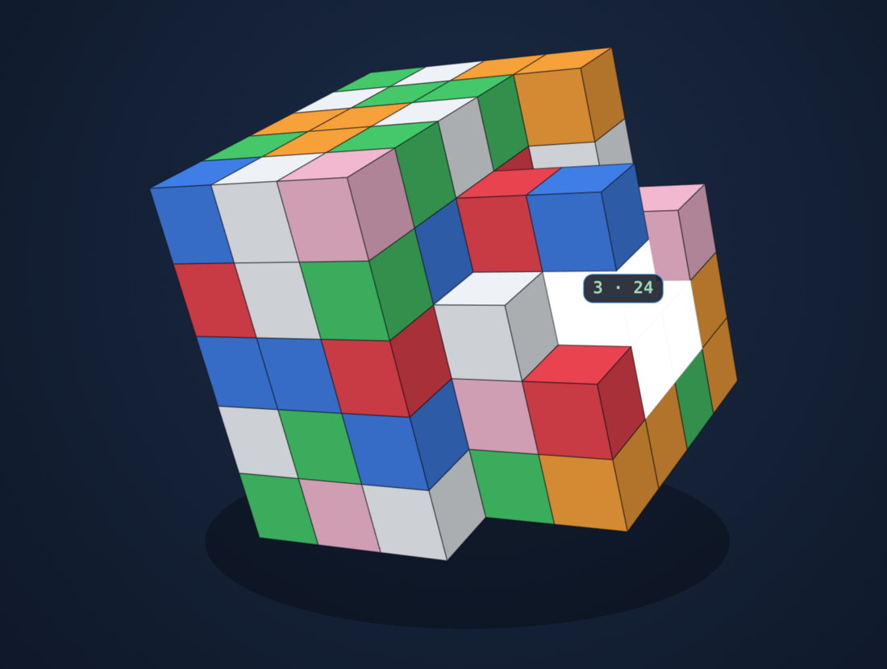

# Cubes

SameGame (Clickomania) played on a **5×5×5 cube** instead of a flat grid.

**Play it:** [bazoocaze.github.io/samecube](https://bazoocaze.github.io/samecube/)
— one HTML file, no dependencies, no build step.

## How to play

1. **Click** a cube — it selects the connected group of same-colour cubes.
2. **Click again** — the group pops and everything above it falls.

Groups of one cube cannot be popped, so the cube is stuck until you open it up. Only cubes with a
visible face are clickable; a hidden cube joins the group as soon as it becomes exposed. Adjacency
is orthogonal — 6 neighbours, so a group can run through the interior of the cube.

**Rotating** (arrow keys, the ◀ ▶ ▲ ▼ buttons, or a swipe on the cube) turns the whole board 90°
around the vertical or horizontal axis. Rotation never makes cubes fall: floating clusters keep
hanging where they are until something pops in their column. A short press selects, a drag rotates.

## Scoring

A group of `n` cubes scores `n × (n − 1) × chain`, where `chain` grows with consecutive pops:

| consecutive pops | chain |
|---|---|
| 1st | 1.0× |
| 2nd | 1.5× |
| 3rd | 2.0× |
| each after | +0.5 |

Selecting a different group resets the chain, so big groups late in a chain are worth a lot —
the hover badge shows `group · points` for the group under the cursor. Clearing the whole cube
pays a **+2000** bonus. The best score is kept in the browser.

The game ends when no group of 2 or more is left.

## Controls

| | |
|---|---|
| click / tap | select, then pop |
| swipe or `← → ↑ ↓` | rotate 90° |
| `N` | new game |
| `U` | undo |
| `S` | shuffle |
| `M` | sound on/off |

Extras: undo, shuffle, sound, pop and fall animations, particles.

Open `index.html` in any browser to play locally.

## License

[MIT](LICENSE) — the code is yours, use, modify and redistribute it freely.
